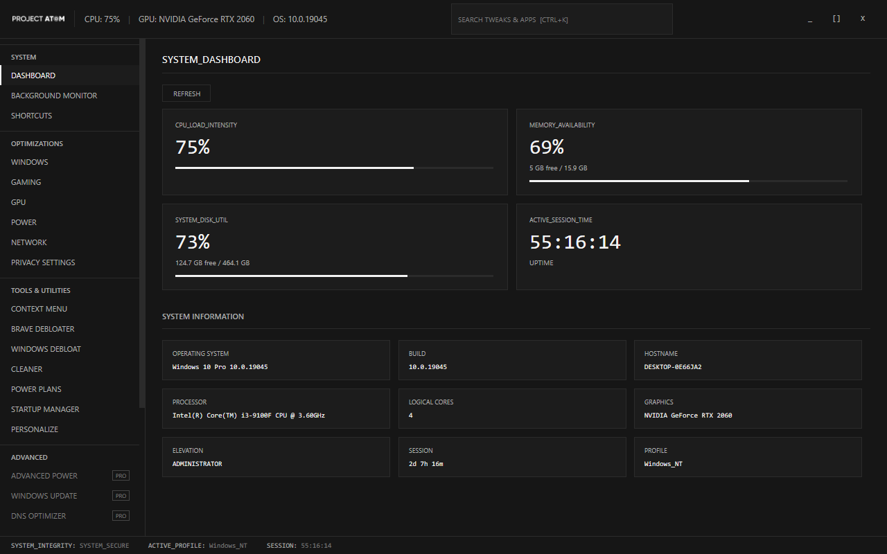
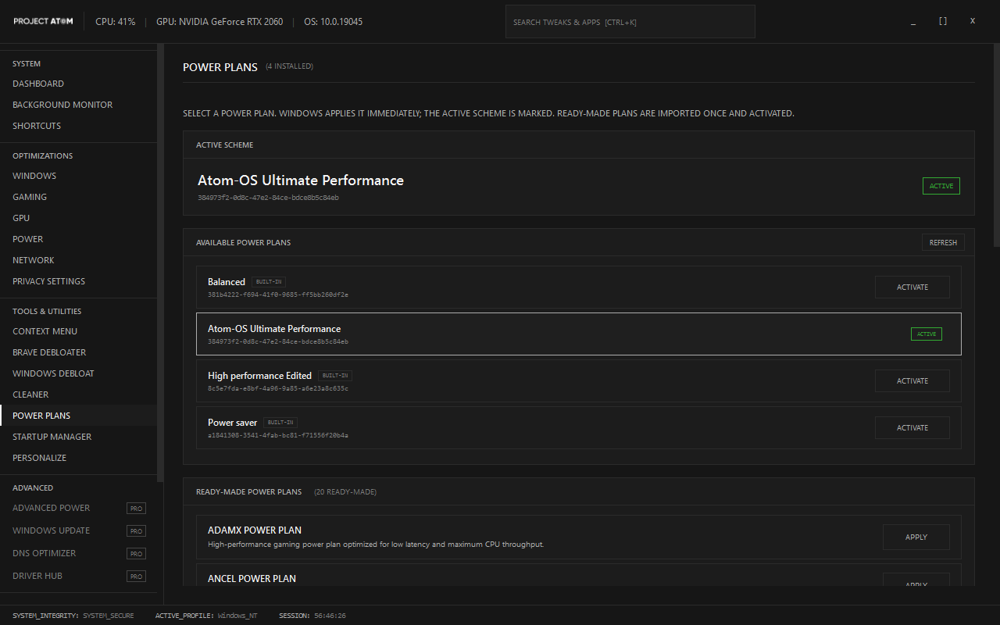

# AtomToolBox 0.2.5

A fast, native Windows 10/11 tuning suite. This is the clean C#/.NET 8 rewrite of the
Electron-based AtomToolBox 0.2.x application — one process, no Node runtime, no WebView and no
third-party NuGet packages.



## Highlights

- **295 tweaks** across 10 catalog pages: **216 free**, 79 PRO.
- **20 ready-made power plans** plus the installed Windows schemes, all in one plan switcher.
- **Native engine** for registry, services, power plans, startup entries, context-menu verbs,
  accent colours, cleanup, backups and hardware probes.
- **Fast shell**: custom-chrome WPF, Dark/OLED/Light themes, global search, smooth scrolling and
  page transitions.
- **Offline installer**: self-contained .NET 8 payload, desktop and Start Menu shortcuts,
  Apps & Features uninstall entry. No runtime prerequisite.



## Install

Download the latest **AtomToolbox-Setup.exe** from
[GitHub Releases](https://github.com/osama5alifa/AtomToolBox/releases/latest). It is a single
51 MB executable; Windows will ask for administrator rights. The versioned asset is
`AtomToolbox-Setup-0.2.5.exe` on the same release.

- Installs to `%ProgramFiles%\AtomToolBox`.
- Creates a public desktop shortcut and a Start Menu shortcut.
- Registers **AtomToolBox** in Apps & Features with an uninstaller.
- Bundles the .NET 8 desktop runtime, so it works offline on a clean Windows 10 1809+ / Windows 11
  x64 PC.
- Keeps user settings, history and backups in `%LOCALAPPDATA%\AtomToolBox` during uninstall.

The portable framework-dependent build is in
[publish/AtomToolbox-0.2.5](publish/AtomToolbox-0.2.5). It requires the .NET 8 Desktop Runtime.

## Power Plans

The Power Plans page is deliberately a switcher, not an editor:

- Lists every installed Windows power scheme.
- Shows the active scheme and its GUID.
- Activates a scheme with one click.
- Lists **all 20 legacy ready-made plans**. Applying one imports it once, caches its GUID and
  activates it; clicking again does not create duplicates.
- No everyday power settings, timer controls or plan editors are exposed on this page.

## Build

Requirements: Windows x64 and the .NET 8 SDK.

```powershell
./build.ps1 -Task Build        # compile
./build.ps1 -Task Test         # headless self-test
./build.ps1 -Task Publish      # framework-dependent portable build
./build.ps1 -Task Setup        # self-contained offline installer (IExpress + self-contained publish)
```

`Setup` publishes a self-contained `win-x64` application and packages it with the Windows
IExpress tool. The result is `publish/AtomToolbox-Setup.exe`, with a versioned copy at
`publish/AtomToolbox-Setup-0.2.5.exe`. The .NET 8 `win-x64` runtime packs must be available in
the NuGet cache (restore once on a networked SDK, then the build stays offline).

Manual build:

```powershell
dotnet build src/AtomToolbox/AtomToolbox.csproj -c Release -p:UseSharedCompilation=false
```

## Project layout

```text
src/AtomToolbox/
  Atom.Toolbox.Domain/          Entities and value objects
  Atom.Toolbox.Application/     Use cases and ports
  Atom.Toolbox.Infrastructure/  Registry, services, powercfg, catalog, security
  Ui/                           WPF shell, views, view models, themes, animations
  Assets/                       Icon, logo and embedded helper scripts
  Program.cs                    Composition root, elevation, single instance, self-test
  SelfTest.cs                   Headless engine diagnostic

installer/                      Setup and uninstall scripts (packaged by IExpress)
tools/
  Atom.CatalogBuilder/          Builds tweaks.json from the legacy JSON + batch scripts
  Atom.LicenseIssuer/           Offline RSA licence tooling
  Atom.ResourceTransfer/        Brands the installer with the app icon and version
  catalog-report.txt            Catalog coverage report

docs/                           Architecture, feature matrix, security, QA, screenshots
```

## How the engine works

The legacy batch scripts are compiled at development time into a typed catalog
(`tweaks.json`). Each tweak is a list of idempotent operations:

| Kind | Execution |
| --- | --- |
| `registry`, `registry-delete` | Direct 64-bit registry API, with read-back verification |
| `service` | `advapi32` service configuration and control |
| `powercfg` | `powercfg.exe` with validated arguments |
| `power-scheme` | Ensures the Ultimate Performance scheme exists, then activates it |
| `accent` | Native DWM + Explorer palette write and shell notification |
| `process`, `powershell`, `batch` | Only where Windows requires an external tool |

The free catalog has **no batch fallbacks**. The 10 remaining fallbacks are all in the gated PRO
catalog (Windows Update, OneDrive/temp removal, consumer features).

## QA and performance

- Release build: **0 warnings, 0 errors**.
- Headless self-test: catalog 295/10, 216 free, 20 plans, 4 installed schemes, 140 power settings,
  startup scan and 18 context-menu entries.
- UI smoke test: **21 pages, 0 dispatcher exceptions**.
- Theme switch, single-instance activation, maximized layout and scroll reset verified.
- Warm launch on the reference machine: **760–777 ms**; working set **~126 MB**
  (framework-dependent). Startup is dominated by WPF/CLR initialization, not application work.

The installer and setup scripts were exercised end-to-end to a temporary install directory,
including copy and uninstall. Shortcut and registry writes require an interactive elevated
session and are part of the release checklist.

## Security

- Catalog SHA-256 integrity check.
- Offline RSA-4096 licence tokens for the PRO boundary.
- `requireAdministrator` manifest, single-instance activation, anti-debug detection.
- No network access is required by the app; the App Installer downloads only the app you choose.
- The build is ready for Authenticode signing and obfuscation as a release step.

See [docs/SECURITY.md](docs/SECURITY.md).

## Catalog regeneration

The generated catalog, plans, shortcuts and debloat data are committed, so the normal build does
not need the old Electron repository. To regenerate them, clone
[AtomToolBox](https://github.com/osama5alifa/AtomToolBox), then run:

```powershell
./tools/Generate-Catalog.ps1 -LegacyRoot C:\path\to\AtomToolBox
```

## Documentation

- [Architecture](docs/ARCHITECTURE.md)
- [Feature matrix](docs/FEATURE_MATRIX.md)
- [Security model](docs/SECURITY.md)
- [QA and verification](docs/QA.md)
- [Changelog](CHANGELOG.md)

## License

MIT — see [LICENSE](LICENSE).
